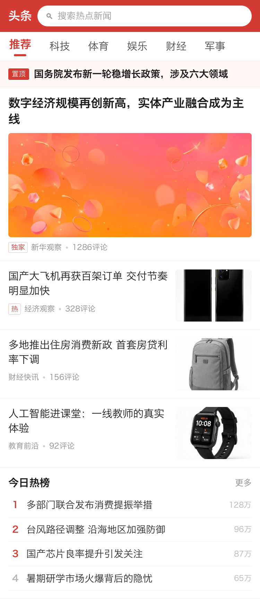
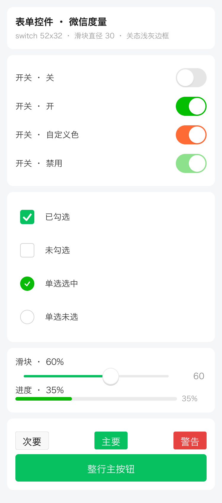

[English](README.md) | **简体中文**

# mini-render

**自绘的小程序渲染引擎。用 Rust 从零实现 —— 不基于 WebView、不映射系统原生控件、不依赖 Skia。**

给它一份微信小程序源码（WXML / WXSS / JS / app.json）和一块可写的像素缓冲，它把界面画出来、
把交互跑起来。对齐目标是微信的 **Skyline**（同样是原生渲染，同样没有 DOM）。

下面四张是引擎自己渲染的输出（纯 WXML + WXSS + 数据，375×667 @2x，无浏览器参与）：

| | | | |
|:---:|:---:|:---:|:---:|
| <br/>电商首页 | <br/>资讯信息流 | <br/>外卖点餐 | <br/>表单控件 |

全部 65 张见 [`doc/场景画廊.md`](doc/场景画廊.md) —— 它们同时是逐字节可复现的回归基线。

落地页：**<https://365code365.github.io/mini-program-core/?lang=zh>**
（站点默认英文，头部有 EN / 中文 切换，带 `?lang=zh` 直接进中文）。

---

## 目录

- [核心介绍](#核心介绍)
  - [它是什么、不是什么](#它是什么不是什么)
  - [一帧是怎么画出来的](#一帧是怎么画出来的)
  - [八个关键设计取舍](#八个关键设计取舍)
  - [现在到什么程度了（实测）](#现在到什么程度了实测)
  - [能力边界：能做什么、明确不做什么](#能力边界能做什么明确不做什么)
  - [适合 / 不适合的场景](#适合--不适合的场景)
  - [技术栈与依赖](#技术栈与依赖)
- [30 秒跑起来（桌面）](#30-秒跑起来桌面)
- [集成进 App（SDK）](#集成进-appsdk)
- [预编译的移动端依赖包](#预编译的移动端依赖包)
- [支持范围](#支持范围)
- [测试与回归](#测试与回归)
- [仓库结构](#仓库结构)
- [文档](#文档)

---

## 核心介绍

### 它是什么、不是什么

一句话：**小程序源码进，像素出**。中间没有浏览器内核、没有系统控件、没有第三方 2D 图形库
（可选的 GPU 后端只拿 wgpu 做图层合成，不画内容）。

```
输入                        引擎（纯 Rust 库）                     输出
────────────────────────────────────────────────────────────────────────────
my-mini-app/                                                    ┌──────────┐
├── app.json      ─┐                                            │  RGBA    │
├── app.wxss       │   解析 → 逻辑层 → 模板求值 → 样式计算        │  像素    │
├── pages/*.wxml   ├─▶  → Flexbox 布局 → 自研 2D 光栅器  ──────▶ │  缓冲    │
├── pages/*.wxss   │      → 分层合成（页面 / tabBar / fixed）     └──────────┘
├── pages/*.js    ─┘                                                  │
└── 图片等资源                                                         ▼
                                                       窗口 / UIView / SurfaceView / PNG
```

产物是一个普通的 Rust 库（`cdylib` / `staticlib` / `rlib`），落地条件只有一条：
**给我一块可写的像素缓冲**。所以同一份代码能跑在 Android、iOS、Windows、macOS、Linux 上，
也能在没有屏幕的 CI 里直接出 PNG。

它和常见方案的区别：

| 方案 | 做法 | 本引擎 |
|---|---|---|
| 微信小程序的 WebView 渲染层 | WXML → DOM，交给浏览器内核排版绘制 | ❌ 不用 DOM、不用浏览器内核 |
| React Native / Weex | JS 描述 → 映射成系统原生控件（`UIView` / `android.view`） | ❌ 不映射系统控件（不受各端控件差异摆布） |
| Flutter | Dart + Skia 自绘 | ✅ 思路最接近，但这里是 **Rust + 自研光栅器**，无 Skia 依赖 |
| Electron / Tauri | 打包/复用一个浏览器 | ❌ 不打包浏览器（产物 34MB 级，不是 100MB 级） |
| 微信 **Skyline** | 原生渲染 + 自绘组件 | ✅ 对齐目标：语义、手感、事件模型都按它对 |

**为什么值得自绘。** WebView 方案的痛点不在「能不能渲染」，而在你**控制不了**：内核版本随
系统走、同一份 CSS 在不同 Android 上排版不同、首屏要等内核起来、滚动与手势的手感由内核决定、
想插一层原生能力就要架桥。自绘把这些变成自己的代码：**布局与绘制逻辑各端只有一份**，帧调度、手势仲裁、内存上限
全都在手里 —— 各端的剩余差异只来自系统字体。要彻底消掉就把字体一起打包
（`assets/SourceHanSansSC-Regular.otf` + `TextRenderer::from_file`），但要先看
[内存那一节](#能力边界能做什么明确不做什么)：内置字体**更费内存**，不是更省。代价也很实：CSS 覆盖面要自己一条一条补
（见[能力边界](#能力边界能做什么明确不做什么)），性能靠 CPU 省着花。

### 一帧是怎么画出来的

八步，每步都能单独打开诊断日志（`MINI_*` 开关见[架构文档](doc/架构与实现原理.md#帧成本是怎么压下来的)）：

| # | 阶段 | 做什么 | 关键实现 |
|---|---|---|---|
| ① | **解析** | WXML → 节点树；WXSS → 样式表 | 手写解析器；CSS 选择器引擎（标签/类/#id/`*`/属性/后代/子代 + 特异性排序），选择器在**解析期就编译**好 |
| ② | **逻辑层** | 跑 `App` / `Page` / `Component`，`setData` 产出数据快照 | QuickJS（rquickjs）；CommonJS 模块、`Promise`/`async`、定时器、微任务每帧 pump |
| ③ | **模板求值** | `{{ }}` 表达式 + `wx:if` / `wx:for` 展开 → 渲染节点树 | 自研表达式引擎；`class`/`style` 绑定到数组/对象时按 CSS 语义拼接 |
| ④ | **样式计算** | 命中的 CSS + 内联 `style` 合成计算样式 | 继承语义（`color` / `font-size` / `font-weight` / `line-height` / `letter-spacing` …）；简写与细项按固定档位排序落地 |
| ⑤ | **布局** | Flexbox 求解盒模型 | taffy 0.12；**文本节点挂自定义度量函数**，换行与 min/max-content 由真实字形宽度决定；布局后有第二遍修正（`reflow`）收拾只有算完才知道的溢出 |
| ⑥ | **绘制** | 逐层画进 RGBA 画布 | 自研 2D 光栅器：扫描线 + even-odd 填充、4× 超采样抗锯齿、圆角三次贝塞尔逼近（K=0.5523）、fontdue 字形 + 多字体回退、Apple `sbix` 彩色 emoji、图片双线性 + 面积两级过滤、线性/径向渐变、掩膜化 `box-shadow`、裁剪栈 |
| ⑥' | **动画** | `@keyframes` / `transition` / `wx.createAnimation` | 在**绘制期**按全局时钟求值：`transform`/`opacity`/颜色只影响绘制，不触发重排 → 动画帧成本≈静态帧 |
| ⑦ | **分层合成** | 正常流 → tabBar → `position:fixed` 覆盖层 | 与浏览器层叠顺序一致（全屏遮罩能压暗 tabBar）；覆盖层用视口坐标、独立画布、按需重绘 |
| ⑧ | **上屏** | 贴到窗口 / 交给宿主 / 存 PNG | 桌面窗体默认走 GPU 合成（wgpu 把图层当纹理合成上屏），不可用时回退 softbuffer；移动端把 RGBA 交给宿主 View；无头模式默认 CPU 合成后直接 `save_png` |

逻辑层与渲染层之间只有**数据快照**这一条通道（`setData` → `Arc<Value>`），没有 DOM、没有
虚拟节点 diff、没有 GC 压力。

### 八个关键设计取舍

这些是「为什么这么写」的核心，踩过的坑都写在 [`doc/踩坑记录.md`](doc/踩坑记录.md)。

1. **文本度量驱动布局，不估算宽度。** `TextMeasure` 上下文挂到 taffy 叶子上，由真实字形参与
   布局。这样「定宽容器内按容器宽换行」和「收缩容器被内容撑开」两种 CSS 语义能同时成立。
   反面教材：曾给每个文本盒 +4px「保险余量」，结果所有按内容定宽的徽标/标签/胶囊都比浏览器宽一圈。
2. **动画只重绘不重排。** `@keyframes` 里改 `width`/`height` 这类会引发重排的属性不生效，
   改 `transform`/`opacity`/颜色都生效。换来的是「动画帧和静态帧一样便宜」。
3. **`setData` 只重绘变化的那一块。** 新旧渲染树并行走一遍，收集「文本/属性变了」或「几何变了」
   的节点包围盒当裁剪矩形。首页秒杀倒计时的失效范围是 **45×33 像素**，不是整屏。
   拿不准就退回整帧 —— 少画一块留下脏像素比多画一次严重得多。
4. **页面滚动不重绘。** 页面画布是整页高的、用内容坐标，滚动只是取不同切片上屏（每帧 2~3ms）。
   只有滚出「已绘制条带」那一刻才补画一次。
5. **滚动手感按 iOS/微信那套做。** 橡皮筋衰减 `1 - 1/(x·0.55/d + 1)`、回弹是带初速度的
   **临界阻尼弹簧**（不是固定时长缓动）、惯性撞边界不当场停死而是把动量交给弹簧。
6. **手势归属不在按下时决定。** 等第一次明显位移（4px）按主方向锁定，再按「到边界仍在推」
   交棒给外层。横向卡片列表里竖着划该滚页面，纵向列表里横着划谁也不动。
7. **宿主层沉进 lib，桌面与移动端共用一份。** 页面栈、覆盖层、触摸状态机、手势仲裁、
   picker 面板、像素合成都在 `src/host/`，只有帧调度各自实现。两条链路由
   `tools/sdk-parity.sh`（逐像素）+ `src/tests/engine_input_tests.rs`（输入行为）双重守着。
8. **内容只在 CPU 上光栅化，GPU 只做合成；不做元素级位图缓存。** 定位仍是「给我一块像素缓冲
   我就能画」：CPU 光栅器是唯一的像素参考，没有 GPU 的 CI、嵌入式照样出同一张图。可选的 GPU 后端
   （feature `gpu`）只把页面 / tabBar / fixed 三个图层当纹理合成上屏，用整数着色器复刻 CPU 的合成
   算术，同一帧与 CPU **逐字节一致**，任何失败当帧回退 CPU（目前接进了桌面窗体与无头，移动端 SDK
   仍走 CPU）。没用 vello / Skia 这类 GPU 光栅库：它们自带抗锯齿与字体栈，「与 CPU 逐字节一致」
   就无从判定。位图缓存与动画/裁剪栈的交互复杂度不值当。抗锯齿也没换成子采样 —— 实测与 Chrome
   的差异反而从 4.7% 涨到 5.3%。

### 现在到什么程度了（实测）

**性能**（375×667 @2x，即 750×1334 物理像素，CPU 逐像素写出）：

| 场景 | 优化前 | 现在 |
|---|---|---|
| 商城首页整帧（轮播 + 每秒倒计时 + 骨架动画） | 49.6 ms | **6.1 ms** |
| 商城首页稳态帧间隔（144Hz 屏，节拍 6.94ms） | 6.9~25 ms 抖动 | **6.7~7.2 ms** |
| 首页最慢一帧 / 帧间隔峰值 | 17.9 / 24.9 ms | **11.4 / 11.4 ms** |
| 一次 `setData` 的重建成本 | 32 ms | **4 ms** |
| 拖动单帧（tea-app 首页，60 帧平均） | 7.17 ms | **3.74 ms** |
| 远程图片二次打开（磁盘缓存） | 6132 ms | **11 ms** |
| 首帧「建树+样式」（三条中文字体栈的应用） | 3093 ms | **955 ms** |

**双端一致性**（同一份源码：一边原生渲染，一边编译成 HTML 用 Chrome 截图，逐像素比）：

| 示例 | 页数 | 与 Chrome 的变化像素比 |
|---|---|---|
| `sample-app`（商城） | 15 | **4.57%** |
| `news-app`（资讯） | 6 | **6.34%** |

剩余差异集中在粗体字形与亚像素文本位置。这个数字是**回归判据**，不是宣传语 ——
任何渲染改动都要先看它有没有变坏。

**跑得起来的真实工程**（不是 demo 级的自造样板）：

| 小程序 | 规模 | 说明 |
|---|---|---|
| `sample/tea-app` | 36 页 | **uni-app 编译到 mp-weixin 的产物**：259KB Vue 3 运行时 + 60 个 CommonJS 模块，用 `Component()` 构造器定义页面 |
| `sample/real-sample` | 8 页 | 微信官方 demo |
| `sample/sample-app` | 15 页 | 商城闭环：购物车 → 确认订单 → 下单 → 订单/物流，跨页状态走 `wx.storage` |
| `sample/news-app` | 6 页 | 资讯闭环：频道横滑、正文字号即时生效、评论、收藏持久化 |

**回归规模**（每次改动都要全绿，命令见[测试与回归](#测试与回归)）：

| 判据 | 规模 |
|---|---|
| 单元测试 | lib **774** + bin **26** + 端到端集成测试 **72**（22 个文件）；其中宿主纯逻辑 41 条（手势仲裁 13 / 侧滑返回 12 / picker 面板 10 / 触摸状态机 6）、SDK 指针链路 7 条 |
| 场景画廊 | **65** 张，固定动画时钟下逐字节可复现 |
| 局部重绘校验 | 增量重绘 vs 强制整帧，5 个场景**逐字节相同** |
| SDK 与桌面一致性 | sample 15/15、news 6/6 **逐像素相同** |
| 指针层与覆盖层 | 6 张确定性交互快照 + 2 条手势断言 + **空转守卫** |
| 编译警告 | **0**（`cargo check --all-targets`） |

### 能力边界：能做什么、明确不做什么

**已实现**（详表见[支持范围](#支持范围)）：

- **26 个组件标签**（容器 / 文本媒体 / 表单三类，含 `swiper`、`scroll-view`、`picker-view`，以及按官方行为实现的 `navigator` / `label`）；
- **事件**：六种绑定前缀（`bind` / `catch` / `capture-bind` / `capture-catch` / `mut-bind` / `bind:`）
  与完整的捕获-冒泡链，触摸序列按微信语义产出（slop 取消 tap、350ms longpress、被滚动接管补 `touchcancel`）；
- **模板**：`wx:if` / `wx:elif` / `wx:else` / `wx:for`、`block`、表达式引擎、`class`/`style` 绑定、
  `template` / `import` / `include`、`wxs` 模块（QuickJS 执行）、`wx:key`（组件实例与交互状态跟着 key 走）、
  `usingComponents` 自定义组件（每处使用一个实例、样式隔离、独立数据作用域、具名 / 默认 / 动态 `<slot>`、`virtualHost`、
  `triggerEvent` 的 `bubbles` / `composed` / `capturePhase`、`wx://form-field` 系列 behavior、`selectComponent`）；
- **样式**：选择器与特异性层叠、继承、`@import`、CSS 变量、`rpx`、`calc()`、渐变、阴影、
  `transform` / `transition` / `@keyframes`、`@media`（宽高 / 方向 / 宽高比 / 深浅色）、`@font-face`（TTF / OTF）；
- **组件行为**：`scroll-view` 的受控位置、滚动 / 触底事件与自定义下拉刷新；`swiper` 的跟手拖动、衔接、
  一屏多项、前后边距、Skyline 的 `direction` / `indicator-type` / `layout-type` 与 change / transition / animationfinish；
  `form` 的 submit / reset；`picker` 的 columnchange / cancel / `header-text`；`picker-view` 内嵌滚轮；
  `<video>` 的播放事件、全屏、封面、弹幕；`<canvas type="2d">`（渐变 / 图案 / 阴影 / 合成模式 / 像素读回）；
- **API**：120 余个 `wx.*`（`request` 含 `abort`、`connectSocket`、`downloadFile` / `uploadFile` 与 `FileSystemManager`（`wxfile://` 沙盒）、
  `InnerAudioContext` / 背景音频、storage 全套且跨启动持久化、
  Toast / Loading / Modal / ActionSheet、`previewImage`、五个路由 API、`pageScrollTo`、`createSelectorQuery`、
  `createIntersectionObserver`、`nextTick`、`createVideoContext`、tabBar 运行时 API、剪贴板、振动、`loadFontFace`、
  设备信息全套、网络状态、胶囊位置、`canIUse`、`getImageInfo` / `compressImage`、`canvasToTempFilePath`、`createAnimation`、
  `createCanvasContext`）。`login` / `chooseImage` / `getLocation` / 存相册 / 录音等 30 个宿主能力：
  宿主在创建选项 `hostApis` 里点名就交给宿主，没点名的立刻 `fail` 并写明原因（不再是 `undefined`）；
- **生命周期**：三级共 28 个钩子（App 7 / Page 13 / Component 5 + `pageLifetimes` 3），
  页面 `onShow/onHide/onResize` 会联动页面内组件；
- **交互**：惯性滚动与临界阻尼回弹、手势仲裁、左边缘侧滑返回（桌面与移动端 SDK）、下拉刷新、picker 底部面板、局部重绘；
- **媒体**：Canvas 2D（完整 2D 上下文 + 设备分辨率后备缓冲）、`<video>`（MP4 解复用 + H.264 软解 + 音频）。

**明确不做**（不是没排期，是取舍）：

| 不做 | 原因 |
|---|---|
| GPU 光栅化 | GPU 只做合成上屏（见[设计取舍第 8 条](#八个关键设计取舍)）；内容一律由 CPU 画，CPU 才能当唯一的像素参考，无 GPU 环境（CI、嵌入式）也出同一张图。要做就是一套与 CPU 并行的第二光栅器（每种图元、文字、渐变、阴影各一遍），这一轮没有做 |
| 解析 `.wxapkg` / 签名校验 | `.wxapkg` 是微信编译后的私有格式（模板已编成 `$gwx` 函数），签名是微信的私钥体系；分包、灰度、完整性属于宿主的事，引擎按**目录**读源码 |
| 把 `<web-view>` / `<map>` 编进引擎 | **Skyline 自己就不渲染 `web-view`**（官方组件支持表：「暂不考虑」，该页面要切回 WebView 渲染）；`map` 在 Skyline 里是同层渲染的原生组件。引擎算位置与参数，控件由宿主用 `WKWebView` / `android.webkit.WebView` / ArkUI `Web()` 放上去（[理由](doc/原生App集成指南.md)） |
| 迁就偏离微信语义的写法 | 对齐目标只有 Skyline 一个。写法与微信不一致时，按微信来。这是原则，不是一个能「实现」的功能（反着做就违背了对齐目标） |

（远程字体从前在这张表里；现在 `wx.loadFontFace` 与 `@font-face` 都真的加载 TTF / OTF，WOFF 明确 `fail`，与 Skyline 一致。）

**还缺的**（原来的 12 条里 4 条已关、其余做了大半，每条都写了影响，见 [`doc/引擎测试说明.md`](doc/引擎测试说明.md) 第六节）：
这一轮（T23~T29）补了 WebSocket / 文件系统 / 音频等 API、组件事件冒泡与 `virtualHost` / 动态 slot、`navigator` / `label`、
`picker-view` 滚动、swiper 的 Skyline 属性、canvas 2d 的渐变阴影与像素读回、video 封面与弹幕；`@supports` / `@container` / `@layer`
查证 Skyline 本身就不支持，两端都整块跳过。还开着的：`wx:key` 参与增量失效与 WXS 响应事件（G-2）、H5 导出的自定义组件（G-2c）、
scroll-view 的滚动条与 Skyline 的 `sticky` / `grid-view` / 嵌套滚动（G-4）、离屏 scroll-view 的受控值（G-5）、video 的拖动进度 /
画中画（G-6）、swiper 的 worklet 回调（G-7）、canvas 的虚线与 clip（G-9）、未注册标签的兜底语义（G-12）。

**最大的已知短板是内存**：峰值 600MB~1GB，几乎全是字体。`cargo run --release --example mem_report`
的实测分项（RSS 增量，macOS）：

| 阶段 | 增量 |
|---|---|
| 系统主字体（Hiragino Sans GB，约 2.9 万字形，常规字面） | **+303 MB** |
| 同一集合的粗体字面（懒加载，第一次画粗体时） | +8~150 MB（取决于集合里字面的大小） |
| 再加一个字体集合（`Songti.ttc` 63.8MB，指定宋体的应用会用到） | **+138~156 MB** |
| 内置 `SourceHanSansSC-Regular.otf`（约 6.5 万字形，单字面） | **+405 MB** |
| 画 1200 个不同汉字（字形**位图**缓存） | +12~31 MB |
| 一块 750×4000 的页面画布 | ≈0 |

两个结论值得记住：**代价跟字形数量成正比，跟文件大小无关**（16.5MB 的 Source Han Sans 比
系统字体更贵，因为字形多一倍多）；**字形位图缓存不是问题**（几十 MB，已按字节封顶）。
所以「内置单字面字体省内存」是错的 —— 实测更贵，内置字体只该为了**跨端一致**而做。

根因是 fontdue 在加载时把字体里每个字形的几何一次性展开。缓存都已按字节封顶
（图片 64MB / 字形 24MB / 2 个字体文件，LRU），也有 `trim_memory()` 给宿主在内存告警时调用，
但真正压峰值只有换惰性字体后端（`swash` / `cosmic-text`）这一条路。**换后端的代码面很小**
（fontdue 的调用全在 `src/text.rs`：5 处 `Font::from_bytes`、4 处 `metrics`、2 处 `rasterize`），
难的是它会改变每个字形的抗锯齿 —— 65 张画廊 + 21 页整帧 + 7 张交互快照的基线全部要重定，
所以这是单独一轮的活，不是一次重构。

### 适合 / 不适合的场景

**适合**

- 自家 App 想内嵌小程序容器，又不想背 WebView 的版本差异与首屏成本；
- 要求**渲染结果可控且可复现**：布局与光栅化各端同一份代码，同一套字体下输出逐像素相同
  （跨系统的差异只来自系统字体；内置字体能消除差异，代价是内存更高，见下）；
- 需要在无屏环境批量出图：营销长图、服务端渲染卡片、UI 回归基线；
- 想把一份小程序源码同时输出成 H5（内置编译器，本仓库正是用它当双端对比的参照）；
- 需要把渲染细节握在自己手里：帧调度、手势手感、内存上限、诊断日志。

**不适合**

- 需要完整 Web 生态（任意 CSS 特性、第三方 H5 SDK、`<iframe>`）—— 那就该用 WebView；
- 重度 3D / 大量滤镜 —— 内容光栅化在 CPU 上（GPU 后端只管合成），撑不住，该上 GPU 绘制的方案；
- 期望「零适配跑通任意线上小程序」—— 还有一批已知差距（见上），复杂应用需要逐项验证；
- 内存极紧的设备 —— 字体后端换完之前峰值偏高。

### 技术栈与依赖

依赖都跟到当前稳定版（`winit` 例外：最新的 0.31 只有 beta，稳定线仍是 0.30；`wgpu` 另算：
大约一季度一个破坏性大版本，所以锁死版本，升级单独立项并重跑全部 GPU 判据）。

| 依赖 | 版本 | 用途 |
|---|---|---|
| [taffy](https://github.com/DioxusLabs/taffy) | 0.12 | Flexbox / block 布局求解（`box-sizing` 真正生效靠它） |
| [rquickjs](https://github.com/DelSkayn/rquickjs) | 0.12 | QuickJS 绑定：逻辑层的 JS 运行时 |
| [fontdue](https://github.com/mooman219/fontdue) | 0.9 | 字形光栅化 |
| [image](https://github.com/image-rs/image) | 0.25 | 图片解码（PNG / JPEG / GIF 逐帧 / WebP 等，走 image 的默认解码器集） |
| [ureq](https://github.com/algesten/ureq) | 3.3 | `wx.request` 与远程图片（必须 `http_status_as_error(false)`，微信里 4xx/5xx 也走 `success`） |
| [tungstenite](https://github.com/snapview/tungstenite-rs) | =0.30.0 | `wx.connectSocket` 的 WebSocket 协议（只开 handshake；TLS 走下面同一份 rustls） |
| [rustls](https://github.com/rustls/rustls) + [webpki-roots](https://github.com/rustls/webpki-roots) | =0.23.42 / =1.0.9 | `wss://` 的 TLS 与根证书（与 ureq 用的是同一份，不多编一套） |
| [base64](https://github.com/marshallpierce/rust-base64) / [flate2](https://github.com/rust-lang/flate2-rs) | =0.22.1 / =1.1.9 | 二进制过桥（WebSocket 帧、文件、像素）/ `FileSystemManager.unzip` 的 deflate（都是 ureq 已带的） |
| [symphonia](https://github.com/pdeljanov/Symphonia) | 0.6 | 音频解复用与解码（AAC / MP3 / MP4） |
| [openh264](https://github.com/ralfbiedert/openh264-rs) | 0.9 | H.264 软解（可选特性 `h264`） |
| [winit](https://github.com/rust-windowing/winit) + [softbuffer](https://github.com/rust-windowing/softbuffer) | 0.30 / 0.4 | 桌面窗口与软件帧缓冲（可选特性 `desktop`；也是 GPU 不可用时的上屏回退） |
| [wgpu](https://github.com/gfx-rs/wgpu) + [pollster](https://github.com/zesterer/pollster) | =30.0.1 / =1.0.1 | GPU 合成后端：Metal / Vulkan / DX12 / GLES（可选特性 `gpu`） |
| [rodio](https://github.com/RustAudio/rodio) | 0.22 | 桌面音频播放（可选特性 `audio`） |
| [jni](https://github.com/jni-rs/jni-rs) | 0.21 | Android JNI 入口（只在 android 目标编译） |

工程规模：**240 个 `.rs` 文件 / 约 5.3 万行**（含 29 个测试文件），单文件超 500 行就拆
（例外要在文件头写理由）。除 FFI 边界（`extern "C"`）外，`unsafe` 只出现在 **`src/compositor/` 的 4 处**
（3 处把像素切片按字节看，1 处用原生窗口指针建 wgpu surface），每处都带 `SAFETY` 注释。没有 `static mut`：
全局状态一律走 `RwLock` / `OnceLock` / `thread_local`。

---

## 30 秒跑起来（桌面）

```bash
# 需要 Rust（https://rustup.rs）
cargo build --release

# 交互式选一个示例小程序
./target/release/mini-launcher

# 或直接指定
./target/release/mini-app-window sample-app
./target/release/mini-app-window sample/tea-app --route pages/index/index
```

无窗口出图（CI / 回归用）：

```bash
./target/release/mini-app-window sample-app --route pages/index/index \
    --settle 0 --time 2 --snapshot target/shot
```

常用动作参数（按书写顺序执行，可重复）：`--touch x,y` / `--swipe x1,y1,x2,y2`
/ `--drag px×帧数` / `--type 文本` / `--key enter` / `--wheel` / `--wait 秒` / `--frames N`。
窗体里 `wx.chooseImage` / `chooseMedia` / `chooseVideo` / `chooseMessageFile` 开系统文件对话框、存相册开「存储为」
（macOS / Windows）；无头 / 自动化用 `MINI_PICK_FILES=/a.png,/b.jpg` 当作选了这些文件、`MINI_SAVE_DIR=<目录>` 指定存到哪，
不给时无头一律 `:fail cancel`。
完整列表 `--help`；诊断开关（`MINI_SCROLL_LOG` / `MINI_FPS` / `MINI_FONT_LOG` / `MINI_SLIDER_LOG` …，移动端 SDK 另有
`MINI_DAMAGE_LOG` 每帧重画多少（GPU 上屏时行尾带准备 / CPU 合成 / 等 surface / 上传量）、`MINI_NO_DAMAGE` 关掉局部重画做对照、
`MINI_NO_RESAMPLE` 关掉页面拖动的按事件时间重采样做对照、`MINI_PACE` 打每帧交帧时刻（配 `tools/pace-check.py` 看屏上每个 vsync 是哪一帧）、`MINI_CPU_PIN=0` 不把 Android 上的引擎线程绑大核（只在交互或连续出帧时绑）；Flutter 插件在 Android 上读
`adb shell setprop debug.mini.fps 1` / `debug.mini.damage_log 1` 这类系统属性，不用重新打包，见集成指南）见
[`doc/引擎测试说明.md`](doc/引擎测试说明.md) 与
[`doc/架构与实现原理.md`](doc/架构与实现原理.md#帧成本是怎么压下来的)。

渲染后端开关。**CPU 光栅是参考实现、永远可用**；GPU 后端（wgpu，默认编进来；只要 CPU 用 `cargo build --release --no-default-features --features desktop,audio,h264`）
是可选的**合成器**：内容仍由 CPU 光栅化，GPU 只把页面 / tabBar / fixed 覆盖层当纹理镜像（按脏区增量上传），
用整数着色器复刻 CPU 的合成算术后直接上屏。同一帧与 CPU **逐字节一致**（`tools/gpu-parity.sh` 守着）。
GPU 初始化失败、自检不一致、运行中设备丢失或 surface 无法恢复，一律当帧回退 CPU，不黑屏、不崩，日志写明原因：

| 开关 | 作用 |
|---|---|
| `--backend auto\|cpu\|gpu` | 后端偏好，不区分大小写，压过 `MINI_BACKEND`。交互窗体默认 `auto`，无头（`--snapshot` 及其上的所有动作）默认 `cpu`。其它取值以退出码 2 结束 |
| `MINI_BACKEND=auto\|cpu\|gpu` | 同上，从环境变量给。SDK 里它压过宿主的 `mr_app_set_backend`（它是诊断开关）。回归脚本都 export 成 `cpu` |
| `--backend-probe` | 按交互窗体的规则选一次后端（编了 gpu 时真的建设备并跑自检）就退出：0 = GPU 可用，3 = 没有可用的 GPU，4 = 没编进 `gpu` feature |
| `MINI_GPU_LOG=1` | GPU 详细日志：初始化耗时、自检样本、surface 格式、每帧合成模式（分层 / 直通）与上传字节数 |
| `MINI_GPU_VERIFY=1` | 无头每帧把 GPU 读回与同一帧的 CPU 合成逐字节比较，不一致以退出码 5 结束 |
| `MINI_GPU_FAULT=init\|selftest\|tint\|lost@N\|surface-lost@N\|timeout@N` | 故障注入，用来测回退：建设备后失败 / 自检判不一致 / 着色器 R+1 / 第 N 帧设备丢失 / 第 N 帧 surface 丢失 / 第 N 帧 acquire 超时 |

`auto` 怎么选：适配器必须是集显或独显（llvmpipe 这类软件适配器一律不算），后端是 Metal / Vulkan / DX12（GLES 只在强制 `gpu` 时用）；
启动自检用一张固定测试帧比较 GPU 与 CPU 输出（必须逐字节一致），并比一次稳态成本（GPU 主线程 ≤ 1ms、GPU 完成 < 4ms；不和 CPU 合成时间比，因为自检量不到 CPU 的上屏开销）。
自检不一致或设备丢失两次会记进判定缓存（`target/gpu/verdict.json` / 移动端沙盒），同一驱动下次直接走 CPU。

启动时打一行选定结果（`🎨 渲染后端：GPU（Metal · Apple M3 Pro）— 自动选择`；不带 gpu feature 编译时是
`🎨 渲染后端：CPU — 未编译 GPU 支持`）；`MINI_FPS=1` 的每秒那行和 `--drag` 的报告行都以后端标签开头，
如 `📊 [后端 GPU · Metal · Apple M3 Pro] …` / `📊 [后端 CPU（回退：设备丢失…）] …`。
GPU 模式下窗口用 `Fifo` 交换链按 vsync 出帧，自己的 sleep + 自旋节拍器关掉。
取下一张 drawable 会阻塞到 vsync，所以 GPU 那行 `MINI_FPS` 的「最慢一帧」和「上屏」都扣掉了这段等待，
单独显示，如 `上屏 0.4[等 vsync 7.9]`。看有没有掉帧以「帧间隔」为准：它是墙上时钟，什么都没扣。

渲染性能基准。关于后端的性能结论一律引用它的输出，不引用零散的 `--drag`：

| 开关 | 作用 |
|---|---|
| `--bench <out.json>` | 逐帧记录并写 JSON。无头（同时给了 `--snapshot`）：`--drag` / `--frames` 的每一帧在 `pump_one_frame` 之后额外合成一次（CPU：`cpu::compose` 进 `Vec<u32>`）并计时。窗口（没给 `--snapshot`）：正常开窗、认 `--route`，按 settle → `--eval` → 逐帧拖动或空转推进，帧照常真实上屏，跑完写 JSON 并退出。每帧带 `phase` / `gpu_frame` / `presented`，顶层记后端、`hz`、`display_hz`（窗口模式）、缩放与提交号。写不进去退出码 1 |
| `--hz <30~360>` | `--bench` 的节拍（默认 144，与交互窗体同一个 sleep + 自旋节拍器）。越界退出码 2 |
| `--bench-shot <png>` | 只在无头下：存第一帧 drive 的合成图 |

```bash
cargo build --release && cargo build --release --examples
cargo run --release --example backend_bench -- --backends cpu --runs 5 --mode both
#   [--scenes all|S1,S3,…] [--out target/_bench] [--gen-only <dir>]
```

`backend_bench` 把夹具小程序生成到 `<out>/apps/`（不进 `sample/`），每个「场景 × 后端 × 缩放」
以 `MINI_FAKE_NOW=2024-03-15`、清空的 `target/mini-storage` 跑 5 次，过防空转守卫，按中位数
写 `<out>/report.md` / `report.json`。有要求的部分没测到（GPU 不可用、窗口模式显示器不是 144Hz）
时退出码 3。CPU 基线见 [`doc/引擎测试说明.md`](doc/引擎测试说明.md#五之三渲染后端基准)。

示例小程序清单、浏览器实时预览（`mini-devserver`）、编译成 HTML 工程、以及把引擎当库用的
Rust / C 代码示例，见 [`doc/示例与调试.md`](doc/示例与调试.md)。

---

## 集成进 App（SDK）

集成方只用**一个 View**。详见 [`sdk/README.md`](sdk/README.md) 与
[`doc/原生App集成指南.md`](doc/原生App集成指南.md)。

### 1. 编库

```bash
bash tools/build-mobile.sh android   # → sdk/android/src/main/jniLibs/<abi>/libmini_render.so
bash tools/build-mobile.sh ios       # → sdk/ios/MiniRender.xcframework（设备 + 模拟器）
bash tools/build-mobile.sh check     # 只做交叉编译检查
```

脚本已经带好了三个**必须**的参数（缺一个都编不过，原因写在脚本注释里）：

| 参数 | 为什么 |
|---|---|
| `--no-default-features` | 关掉桌面依赖：`winit` 在 android 目标必须选 activity 后端否则编译失败；`arboard`（剪贴板）只支持桌面；`rodio` 要开系统声卡 |
| `--features bindgen` | `rquickjs-sys` 没有为 iOS/Android 预生成 C 绑定，要现场生成 |
| `IPHONEOS_DEPLOYMENT_TARGET` | rustc 默认按 iOS 10 链接，而 C 依赖按 SDK 新版本编，不一致会缺 `___chkstk_darwin` |

特性开关：

| 特性 | 默认 | 说明 |
|---|---|---|
| `desktop` | ✅ | 桌面窗体（winit + softbuffer + 剪贴板） |
| `audio` | ✅ | 内置音频播放（`<video>` 的声音） |
| `h264` | ✅ | 内置 H.264 软解。**移动端建议关掉**：交给系统播放器硬解更省电，且 openh264 在 iOS 模拟器目标上编不过 |
| `gpu` | ✅ | GPU 合成后端（wgpu），运行时选、失败回退 CPU。Android 与 iOS 库默认带（原生视图把 `ANativeWindow` / `CAMetalLayer` 交给 `mr_app_attach_surface`，偏好 auto；C ABI 默认偏好仍是 cpu；`ANDROID_GPU=0` / `IOS_GPU=0` 关掉）；Flutter 的 iOS 插件走 CVPixelBuffer 纹理，照旧 CPU |
| `bindgen` | ❌ | 交叉编译时打开 |

### 2. 打成依赖（推荐）

**Android（AAR → Maven）**

```bash
bash tools/build-mobile.sh android
cd sdk/android && ./gradlew publishToMavenLocal
```

业务工程：

```kotlin
repositories { mavenLocal() }                       // 或你的内网 Maven
implementation("dev.minirender:mini-render:0.1.0")
```

**iOS（Swift Package / CocoaPods）**

```swift
// Package.swift
.package(path: "../mini-program-core/sdk/ios")      // 或 .package(url: ..., from: "0.1.0")
```

```ruby
# Podfile
pod 'MiniRender', :path => '../mini-program-core/sdk/ios'
```

### 3. 接入代码

Android：

```kotlin
val mini = MiniProgramView(this)
setContentView(mini)
mini.open(File(filesDir, "my-mini-app"))          // 解包后的小程序目录

override fun onBackPressed() {
    if (!mini.goBack()) super.onBackPressed()      // 页面栈空了才退出
}
override fun onResume() { super.onResume(); mini.onHostResume() }
override fun onPause()  { super.onPause();  mini.onHostPause() }
```

iOS：

```swift
let mini = MiniProgramView(frame: view.bounds)
view.addSubview(mini)
mini.open(appDir: unpackedDir)

if !mini.goBack() { navigationController?.popViewController(animated: true) }
```

两个 View 内部包好了：专用渲染线程（引擎不是线程安全的）、尺寸与 dpr 换算、
触摸三段（含历史点 / `coalescedTouches`，不抽稀）、按需出帧（静止不耗电）、
沙盒目录、生命周期与内存告警。

### 4. 只有两件事必须你决定

1. **小程序包从哪来**：下载 / 校验 / 解包到沙盒。引擎按**目录**读，不解析 `.wxapkg`、
   不做签名校验 —— 分包、灰度、完整性属于宿主的事。
2. **原生层组件谁承载**：`<web-view>` / `<video>` / `<map>` 在微信里是原生组件层
   （层级最高，只有 `cover-view` 能盖住）。引擎算位置与参数，控件由你用
   `WKWebView` / `android.webkit.WebView` / ArkUI `Web()` 放上去。
   **不建议把 wry 编进引擎**（鸿蒙无后端、Android 要求改宿主 Activity），
   理由详见集成指南。

### 产物体积（arm64 实测）

| | |
|---|---|
| Android `.so`（strip 后） | 34.4 MB |
| iOS 静态库 `.a` | 184 MB（链进 App 后会被死代码消除大幅缩减） |

偏大，两个已知原因还没优化：`page_loader.rs` 用 `include_str!` 把示例小程序当兜底
内置了（正式 SDK 该去掉）；symphonia / openh264 解码器整个链进来了（移动端可关 `h264`）。

---

## 预编译的移动端依赖包

由本仓库用 `tools/build-mobile.sh` 编出，随 Release 一起发布 —— 集成方不装 NDK、不装 Xcode 也能用：

| 附件 | 内容 | 怎么用 |
|---|---|---|
| `mini-render-android-<版本>.zip` | `arm64-v8a` / `armeabi-v7a` / `x86_64` 三个 ABI 的 `libmini_render.so`（已 strip），外加 Kotlin 的 `MiniProgramView` / `MiniEngine` 与 Gradle 模块 | 直接丢进 `src/main/jniLibs/`，或 `./gradlew publishToMavenLocal` 打成 AAR |
| `mini-render-ios-<版本>.zip` | `MiniRender.xcframework`（真机 arm64 + 模拟器 arm64）、带 `module.modulemap` 的 C 头、`Package.swift`、`MiniRender.podspec`、Swift 的 `MiniProgramView` | Swift Package（`.package(url:)`）或 CocoaPods（`pod 'MiniRender'`） |

发布页：<https://github.com/365code365/mini-program-core/releases>

每个附件旁边都有 `SHA256SUMS`，用前先核对：

```bash
shasum -a 256 -c SHA256SUMS
```

更推荐自己编（特性开关自己定）：

```bash
bash tools/build-mobile.sh android   # → sdk/android/src/main/jniLibs/<abi>/libmini_render.so
bash tools/build-mobile.sh ios       # → sdk/ios/MiniRender.xcframework
bash tools/package-mobile.sh         # → dist/mini-render-{android,ios}-<版本>.zip + SHA256SUMS
```

Release 由 CI 产出：推一个 `v*` tag 就会跑
[`.github/workflows/release-mobile.yml`](.github/workflows/release-mobile.yml) ——
Android 在 ubuntu runner 上编、iOS 在 macOS runner 上编，然后把两个 zip 和 `SHA256SUMS`
挂到 Release 上。注意 zip **不是逐字节可复现的**（zip 会记时间戳），所以每次构建都随包发自己的校验和。

这两个包里 `h264` 特性都是**关的**：移动端该把播放交给系统播放器（硬解、省电、遵守音频焦点），
而且 openh264 在 iOS 模拟器目标上编不过。`<video>` 仍参与布局与命中，只是不出画面帧。

---

## 支持范围

| 类别 | 已支持 |
|---|---|
| 组件（24 个标签） | 容器：view / block / scroll-view / swiper / swiper-item<br/>文本与媒体：text / rich-text / icon / image / video / canvas<br/>表单：button / input / textarea / switch / slider / progress / checkbox / checkbox-group / radio / radio-group / picker / picker-view / picker-view-column |
| 补齐的官方组件 | 渲染器：grid-view（对齐网格 / 瀑布流）、cover-image / cover-view、span、movable-area；宿主没接的 map / camera / live-* / web-view / channel-* 画占位<br/>内置组件（WXML + JS，用到才注入，`src/builtin_components`）：movable-view、page-container、match-media、root-portal、page-meta、navigation-bar、draggable-sheet、8 个手势组件、audio、editor（纯文本） |
| 动画 | `this.animate` / `clearAnimation`（含滚动时间线）、`wx.worklet`（shared / derived / timing / spring / decay / sequence / repeat / delay / Easing）与 `applyAnimatedStyle`：按选择器写节点样式（data 的 `__nodeStyles`） |
| 触摸 | touchmove / touchend / touchcancel 锁定在 touchstart 的节点上（与微信、DOM 一致），手指移出、节点被挪走都照样收到 |
| 事件 | touchstart/move/end/cancel、longpress/longtap、tap、change、focus/input/blur/confirm、image 的 load/error、scroll-view 的 scroll / scrolltoupper / scrolltolower / refresher*、swiper 的 change / transition / animationfinish、form 的 submit / reset、picker 的 columnchange / cancel、video 的 play / pause / ended / timeupdate / loadedmetadata / seekcomplete / fullscreenchange / error、页面 onPageScroll / onReachBottom / onPullDownRefresh；六种绑定前缀（bind / catch / capture-bind / capture-catch / mut-bind / bind:）与捕获-冒泡完整链路 |
| WXML | wx:for / wx:if / elif / else / for-item / for-index / wx:key、block、表达式引擎（含展开与对象简写）、class 与 style 绑定、template / import / include、wxs 模块（`<wxs src>` / 内联 / require）、自定义组件（usingComponents，每处一个实例、具名与默认 slot） |
| WXSS | 标签/类/id/属性/伪类选择器、后代与子代组合器、特异性层叠、`:first/last/only-child`、`:nth-child(An+B)`、`:active`、`@import`、`@keyframes`、`@media`、`@font-face`、CSS 变量、rpx、渐变、阴影、transform、transition/animation |
| wx.\*（官方 503 个都在，要宿主的默认立刻 fail，见集成指南） | TCP / UDP、Worker、WebAudio、EventChannel、路由事件、媒体查询、离屏画布、getRandomValues、request（含 abort）、connectSocket、downloadFile / uploadFile、FileSystemManager、InnerAudioContext / 背景音频、canIUse、网络状态、胶囊位置、getImageInfo / compressImage、canvasToTempFilePath、storage 全套、showToast / showLoading / showModal / showActionSheet、previewImage、下拉刷新、pageScrollTo、createSelectorQuery / createIntersectionObserver / nextTick、createVideoContext、createAnimation、createCanvasContext 与 canvas 2d 节点、tabBar 运行时 API、剪贴板、振动、loadFontFace、导航栏 API、设备信息全套、五个路由 API、App 级监听（onError 等）；login / chooseImage 等宿主能力经 hostApis 交给宿主 |
| 交互 | 惯性滚动与临界阻尼回弹、手势仲裁（主轴锁定 / 内外层交接）、左边缘侧滑返回（桌面与移动端 SDK）、下拉刷新、picker 面板、操作菜单、图片预览、全屏视频、局部重绘（损伤区） |

**图标**用的是 WeUI 官方矢量数据（`success` 是实心圆挖出对勾形的洞，不是白色描边对勾）。

已知差距（`wx:key` 不参与增量失效、H5 导出不支持自定义组件、scroll-view 的 Skyline 专有布局组件…）列在
[`doc/引擎测试说明.md` 第六节](doc/引擎测试说明.md)，每条都写了影响。

---

## 测试与回归

一条命令跑完下面全部（含逐页快照与 H5 对比），每步计时，汇总在 `target/_regress/summary.txt`。
改了引擎之后约 4 分钟：编全部目标 ~20s、各项检查 ~200s。为此 `release` 关了 LTO、开了增量
（thin LTO 要给五十来个二进制各重新优化一遍：2905s 对 20s，gallery 输出逐字节相同）；
发出去的移动端库由 `tools/build-mobile.sh` 开回 thin LTO。

```bash
bash tools/regress.sh            # 加 --no-h5 跳过 H5 对比
```

逐条手跑：

```bash
rm -rf target/mini-storage                 # ① 必做，见下
cargo test --release                       # ② lib 774 + bin 26 + 集成 72
bash tools/damage-check.sh                 # ③ 增量重绘 == 整帧重绘（逐字节）
cargo run --release --example gallery      # ④ 65 张场景图
bash tools/tab-click-check.sh              # ⑤ 三个 app 的 tabBar 点击
bash tools/sdk-parity.sh                   # ⑥ 移动端 SDK 与桌面窗体逐像素一致
bash tools/interaction-check.sh target/_ia # ⑦ 指针层与覆盖层（picker/Modal/按压/手势）
bash tools/clean-target.sh                 # ⑧ 清理（必做，见下）
```

改 `site/`（GitHub Pages 落地页）时：

```bash
python3 tools/site-i18n-check.py    # 中英键对齐、无残留中文、两语言结构一致
python3 tools/site-render-check.py  # 真开 headless Chrome：默认英文、?lang=zh 切中文
```

页面**只有一份版式**：英文写在 HTML 里，中文在 `site/assets/i18n.js` 的表里。
第一个检查在 Pages 工作流里也会跑 —— 少一个键的症状是那一段静默留在英文，页面照样能打开。

涉及渲染的改动再加逐页快照 + 与 HTML 参照实现对比：

```bash
bash tools/snapshot-all.sh sample-app target/fin2_sample --settle 0 --time 2
./target/release/examples/compare --all --rust-from target/fin2_sample --out target/fin2_cmp
python3 tools/pixdiff.py a.png b.png       # 差异占比 + 包围盒
```

当前基线：sample-app **4.57%**、news-app **6.34%**（与编译出的 HTML 对比的变化像素比）。

### 两条硬规则

**跑完必须清 `target/`。** 每个截图/对比工具都往 `target/<自己起的名字>` 里写，
一轮回归多出几十个目录，实测涨到过 **26GB**。

```bash
bash tools/clean-target.sh            # 清测试产物 + target/debug（保留 release，不重编）
bash tools/clean-target.sh --targets  # 再清交叉编译目标目录（iOS/Android，约 6GB）
bash tools/clean-target.sh --all      # 连 cargo 缓存一起清
bash tools/clean-target.sh --dry      # 先看会删什么
```

基线目录（`target/fin2_*`）也一并清 —— 一条 `snapshot-all.sh` 就能重新生成。

**跑快照前必须 `rm -rf target/mini-storage`。** 无头点击会把数据落到
`target/mini-storage/<app>.json`，下次启动读回来页面内容就变了，曾让购物车页从
1.51% 假崩到 10.05%。另外 `sample-app` 的基线必须用 `--settle 0`（首页有延时浮层，
`--settle ≥ 0.5` 会造成 93.9% 的假差异）。

细则见 [`.kiro/steering/30-test-and-cleanup.md`](.kiro/steering/30-test-and-cleanup.md)。

---

## 仓库结构

```
src/
├── parser/          WXML / 模板与表达式引擎
│   ├── expr/        表达式 5 片：分词 / 递归下降解析 / 求值 / JS 值语义（真值·类型转换）
│   └── wxss/        WXSS：`parser`（文本→规则）+ `selector`（选择器引擎）+ 样式表查询
├── renderer/        渲染器
│   ├── components/  24 个标签的建树与绘制（含 WeUI 图标字形表、SVG 路径解析）
│   │   ├── registry.rs  **标签 → 组件行为的唯一登记点**（build/draw/叶子/归因/状态/裁剪）
│   │   ├── base/      公共底座：类型 / 文本度量 / 换行 / 事件属性 / 样式落地 / 盒子绘制
│   │   ├── canvas/    canvas 2D 上下文 7 片：状态 / 图形 / 路径 / 文字 / 渐变 / 上下文管理器
│   │   └── video/     视频 5 片：MP4 容器 / H.264 解码 / 音轨 / 播放状态机
│   └── wxml_renderer/  布局缓存 / 绘制调度 / 命中测试 / 动画 / 局部重绘失效
├── host/            **宿主层（平台无关）**：页面栈、覆盖层、触摸状态机、像素合成
│   ├── picker_sheet/  底部选择面板 6 片：状态与几何 / 构造 / 绘制 / 省市区联动 / 指针闭环 / 滚轮拖动（跟手、甩动、吸附）
│   └── engine.rs      MiniEngine —— 移动端 SDK 的核心
├── js/              QuickJS 绑定；`prelude/*.js` 是按域拆分的逻辑层前置代码
│                    （module / console / storage / ui / route / device / network …）
├── runtime/         MiniApp（逻辑层驱动、定时器、桥事件）
├── ui/              交互管理（`interaction/` 6 片：元素表 / 命中 / 输入编辑 / 指针 / 动画）、滚动控制器
├── compiler/html/   编译成 HTML 工程（双端对比的参照实现）
│                    `transpile/` 4 片（CSS / 标签 / 组件内部结构 / 输出），
│                    `runtime/*.js` 是浏览器端响应式运行时（9 片，按序 include_str! 拼接）
├── ffi_app.rs       App 级 C ABI（mr_app_*）
├── ffi_jni.rs       Android JNI 入口
└── bin/             桌面宿主
    ├── window.rs      只剩 struct + new() + main()（从前 1877 行装了四件事）
    └── app_window/    按职责分片：winit_app（winit 适配）/ frame（出帧闸门）/
                       frame_render（合成上屏）/ page_host（页面栈路由）/
                       scroll_host / tabbar_host / overlay_host / headless_run

sdk/                 Android（AAR）/ iOS（XCFramework + SPM + CocoaPods）
tools/               构建与回归脚本
examples/            画廊、双端对比、内存/字体探针、SDK 一致性
sample/              示例小程序（sample-app / news-app / tea-app …）
doc/                 文档与场景图
```

**桌面宿主与移动端 SDK 共用 `src/host/`**，只有帧调度各自实现；
`tools/sdk-parity.sh` 逐像素守着这条边界（当前 sample 15/15、news 6/6 一致）。

工程约定：单个 `.rs` 超过 500 行就拆（例外要在文件头写理由），见
[`.kiro/steering/`](.kiro/steering/)。各模块的职责与渲染器内部的分工见
[`doc/架构与实现原理.md`](doc/架构与实现原理.md#分层结构)。

---

## 文档

| 文档 | 内容 |
|---|---|
| [`doc/架构与实现原理.md`](doc/架构与实现原理.md) | 一帧是怎么画出来的、分层与模块划分、帧成本怎么压下来、局部重绘、滚动手感与触控对齐、依赖版本与 taffy 适配 |
| [`doc/示例与调试.md`](doc/示例与调试.md) | 示例小程序清单、`examples/` 各示例、浏览器预览、编译成 HTML、视频/Canvas、Rust/C/移动端代码示例 |
| [`doc/场景画廊.md`](doc/场景画廊.md) | 65 张真实渲染（同时是回归基线），以及素材怎么生成 |
| [`doc/踩坑记录.md`](doc/踩坑记录.md) | 13 类「曾经错在哪」：现象 → 根因 → 现在的做法 → 回归判据 |
| [`doc/滑动顿挫避坑清单.md`](doc/滑动顿挫避坑清单.md) | 真机滑动「屏上重复帧」的判据、宿主上屏 / 引擎失效 / 量具三层的坑、Flutter 与原生示例的当前数字 |
| [`doc/引擎测试说明.md`](doc/引擎测试说明.md) | 能力矩阵、T1~T29 逐项测试清单与判据、内存分项实测、已知差距 |
| [`doc/原生App集成指南.md`](doc/原生App集成指南.md) | 极简集成、宿主九件事、C ABI、iOS/Android/鸿蒙步骤、验收清单 |
| [`doc/触控对齐测试报告.md`](doc/触控对齐测试报告.md) | 滑动/点击/长按/手势与微信的逐项对照实测 |
| [`doc/实现组件说明.md`](doc/实现组件说明.md) | 组件实现状态明细 |
| [`sdk/README.md`](sdk/README.md) | SDK 三行接入与三条必须知道的约定 |

## 已知的最大待办

三件，按优先级：

1. **内存峰值**（600MB~1GB，98% 是字体）—— 要换惰性字体后端，细节见
   [能力边界](#能力边界能做什么明确不做什么)那一节；
2. **`setData` 仍会整棵重建布局树**（首页每秒那一帧约 11ms，卡在 144Hz 预算边缘）——
   要做增量树打补丁，基础设施（`FramePlan` / 损伤区 / `damage-check.sh`）已经就位；
3. **移动端 SDK 的左边缘侧滑返回**还没接 —— 它要在页面被覆盖那一刻留一张视口图，
   属于宿主的帧管理，跟 SDK 的局部重绘一起做更合适。

## 许可

MIT。内置图标矢量数据来自腾讯官方开源的 WeUI（MIT）。
